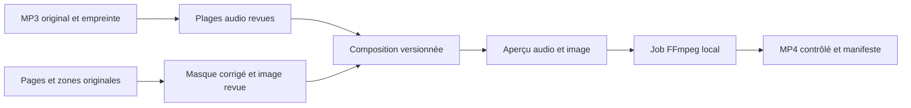

# Conception détaillée — application Windows de vidéos d’ayat

Version documentaire 1.1 — 11 octobre 2026 — proposition de conception, sans implémentation.

## 1. Objectif et périmètre

L’application doit produire une vidéo MP4 par ayah du Coran en riwayat Warsh. Chaque vidéo associe un passage de récitation choisi par l’utilisateur à une image de l’ayah extraite du Mushaf de notre source officielle. La cible principale est la préparation de vidéos pour la chaîne YouTube de l’utilisateur.

### 1.1 Besoins confirmés

| ID | Besoin |
|---|---|
| B01 | Application desktop Windows, indépendante du site pour son utilisation quotidienne |
| B02 | Coran Warsh complet : index des sourates et ayat, texte recherchable et images |
| B03 | Réutilisation des images et métadonnées déjà disponibles dans le dépôt |
| B04 | Téléchargement des MP3 de toutes les sourates d’un récitateur et possibilité de changer de récitateur |
| B05 | Studio manuel de sélection de l’ayah, début/fin, écoute, ajustement et enchaînement |
| B06 | Gestion pratique des reprises du récitateur, sans modèle ni classification des أوجه |
| B07 | Image contenant uniquement l’ayah, avec écriture, signes, couleurs et numéro d’origine |
| B08 | Conservation de la disposition des mots et lignes dans l’image extraite |
| B09 | Export MP4 de l’ayah avec audio et image pendant la récitation |
| B10 | Travail sauvegardé localement, réouverture et déplacement du dossier de projet |
| B11 | Développement avec le SDK .NET 9 déjà installé ; cible `net9.0-windows` |
| B12 | Livraison d’un installateur Windows utilisable sans SDK ni installation manuelle des outils |
| B13 | Interface entièrement en arabe et RTL, adaptée à une personne non informaticienne |
| B14 | Parcours simple, réglages automatiques et architecture sans suringénierie |

### 1.2 Décisions confirmées et valeurs par défaut

- Windows 11 x64 comme plateforme de recette principale. Compatibilité d’autres versions Windows à vérifier explicitement avant de l’annoncer.
- C# et **.NET 9**, conformément au choix utilisateur ; WPF et MVVM léger, SQLite et dossiers locaux. Un projet applicatif et un projet de tests suffisent.
- Interface en arabe, RTL ; horloges, chemins et valeurs numériques isolés en LTR. Libellés explicites hérités des retours utilisateur.
- Récitateur initial : Saber Abdelhakam, à partir de l’inventaire existant. Ajout d’autres récitateurs par fichiers locaux ou manifeste d’URLs.
- Image fixe par défaut, MP4 horizontal 1920 × 1080, 30 images/s ; profil vertical 1080 × 1920 disponible. Fond blanc, proportions conservées, sans animation par défaut.
- Plusieurs occurrences audio possibles pour une même ayah ; choix explicite de celle utilisée pour l’export.
- Export individuel puis par lot, sans publication automatique.

Le choix .NET 9, la livraison installable, l’arabe RTL et la simplicité sont des exigences confirmées. Les valeurs de cadrage et le comportement des ayat longues restent à vérifier sur le prototype. Aucun passage à une autre version majeure de .NET n’est prévu dans ce plan.

### 1.3 Hors périmètre initial

Reconnaissance automatique fiable des limites d’ayat, qualification des أوجه, OCR comme source du texte, synchronisation cloud, comptes utilisateurs, rôles de validation multi-utilisateur, publication YouTube automatique et surlignage mot à mot pendant la récitation.

## 2. Ressources réellement disponibles et réutilisation

État inspecté dans ce dépôt le 11 octobre 2026 ; les chemins ci-dessous sont relatifs à sa racine.

| Ressource | Emplacement | Usage et limites |
|---|---|---|
| 604 PNG et 604 JSON de zones | `data/mushaf/editions/marw-newMushaf/20260913-full/` | 1 208 fichiers référencés et présents ; images totalisant 139 575 979 octets. Le contrôle de présence ne remplace pas la revérification des empreintes à l’import |
| Manifeste images/JSON | Même dossier, `manifest.json` | URLs, dimensions à lire dans les PNG, SHA-256, révision ; importer en lecture seule |
| Texte candidat Warsh | `data/reference/warsh-qpc-v10/source.json` | 6 214 entrées ; adapté à l’indexation, statut candidat conservé |
| Provenance du texte | `data/reference/warsh-qpc-v10/manifest.json` et `README-source.md` | Miroir communautaire, révision Git et empreinte ; ne pas présenter ce fichier comme téléchargé directement de l’éditeur officiel |
| Comparaison structurelle | `data/reference/warsh-qpc-v10/comparison.json` | Références concordantes et 62 différences de métadonnées de page, dont des plages de pages ; pas 62 erreurs de texte démontrées |
| Inventaire audio | `data/reference/archive_org_114_inventory.json` | Importer les associations explicites sourate/fichier/URL, vérifier leur actualité au téléchargement |
| MP3 locaux | `data/audio/sources/NNN/original.mp3` | Réutiliser ceux effectivement présents, après identification et empreinte ; ne pas présumer que les 114 sont téléchargés |
| Géométrie existante | `src/Quran.Infrastructure/Services/MarwPilotCorpus.cs` | Conversion des pourcentages imbriqués en pixels et gestion des continuations |
| Débuts de sourate | `MarwOpeningReview.cs` et `src/Quran.Infrastructure/Data/marw-opening-review.json` | Corrections liées aux empreintes image/JSON ; reprendre seulement pour la même révision |
| Bilan visuel | `docs/research/marw/opening-review-full.md` | Revue assistée des 114 débuts, pas certification exhaustive de toutes les zones |
| Recherche | `src/Quran.Application/Common/QuranSearchQuery.cs` | Normalisation, références et minimum de trois lettres ; tester les signes Warsh particuliers avant réutilisation |
| Traitement audio existant | `src/Quran.AudioProcessor/Services/FfmpegAudioProcessor.cs` | Référence de comportement ; nouveau moteur desktop avec arguments structurés et FFprobe JSON, sans recopier aveuglément l’analyse de stderr |
| Polices de prévisualisation du texte | `src/Quran.Web/wwwroot/fonts/` | Police et licence ensemble. Éviter le mélange de polices à l’intérieur d’un mot |

Le projet n’a pas besoin d’accéder à la base PostgreSQL du site. L’import des anciennes annotations web sera facultatif, à partir d’un export explicite et vérifié, jamais une dépendance du premier démarrage.

Le nombre attendu pour l’édition actuelle est 114 sourates et 6 214 références d’ayat, avec 285 ayat pour Al-Baqara. Ces valeurs identifient cette édition ; ne pas les généraliser à toutes les éditions portant la mention Warsh.

## 3. Parcours utilisateur et écrans

### 3.1 Premier démarrage

L’installateur prépare l’application, son runtime et ses outils médias. Le pack du Mushaf et du texte est livré avec l’installation ou comme fichier compagnon détecté automatiquement. L’utilisateur n’a pas à connaître le dépôt, SQLite, les manifestes ou FFmpeg.

1. L’écran de bienvenue propose `ابدأ` et un dossier de travail par défaut dans Documents ; changer ce dossier reste facultatif.
2. L’application prépare et vérifie les ressources en arrière-plan avec une progression arabe. Si le pack manque, un seul bouton permet de le sélectionner.
3. Le récitateur initial est présélectionné. L’utilisateur choisit une sourate puis `تحميل التلاوة` ou `اختيار ملف صوتي`.
4. L’application ouvre le studio et restaure automatiquement le dernier travail aux lancements suivants.

Le contrôle des empreintes, l’indexation du texte et la détection des codecs restent internes. Internet sert aux téléchargements manquants ; les ressources présentes sont utilisables hors ligne.

### 3.2 Navigation principale et simplicité

Trois entrées principales seulement, toutes en arabe :

| Entrée | Contenu et actions |
|---|---|
| `المكتبة` | Sourates, recherche, récitateur, téléchargement ou ajout d’un audio |
| `إعداد الفيديو` | Parcours guidé : choisir l’ayah, délimiter la récitation, vérifier l’image, prévisualiser et créer la vidéo |
| `فيديوهاتي` | Vidéos terminées et en cours, ouvrir le dossier, réessayer une erreur |

Les paramètres, la sauvegarde et À propos sont accessibles par un menu secondaire. La correction des images est un panneau du parcours, pas un écran supplémentaire obligatoire. Les collections techniques et identifiants restent internes ; l’utilisateur voit le nom du récitateur et, si nécessaire, un nom d’enregistrement.

Règles d’expérience utilisateur obligatoires :

- Une action principale claire par étape, des boutons avec texte arabe, aucune icône seule indispensable.
- Sauvegarde automatique ; retour au dernier travail ; annulation accessible. Aucun formulaire technique à remplir avant de commencer.
- Début/fin affichés en minutes et secondes ; bouton visible pour placer le début. Millisecondes brutes, ajustements très fins, reprises et assemblages dans `خيارات إضافية`, fermé par défaut.
- Export courant : choisir horizontal ou vertical, voir l’aperçu et cliquer `إنشاء الفيديو`. Codecs, fps, débits et paramètres FFmpeg sont prédéfinis en interne, sans formulaire de configuration utilisateur.
- Les corrections complexes et scènes multiples n’apparaissent que si le cas les nécessite ; ne jamais demander de valider une liste de paramètres inutiles pour une ayah simple.
- Messages d’erreur arabes expliquant quoi faire, avec détails techniques repliés. États simples : `لم يجهز بعد`، `يحتاج مراجعة`، `جاهز`، `تم إنشاء الفيديو`.
- Fenêtres, dialogues, aide, confirmations et ordre de navigation en RTL. Isoler en LTR uniquement horloges, références numériques et chemins pour qu’ils restent lisibles.
- Vérification humaine conservée pour le son et l’image, présentée comme une écoute et un aperçu simples, sans circuit administratif de validation.

### 3.3 Recherche et texte

- Champ : « أكتب كلمة أو آية أو رقم » ; ne pas employer « عبارة » dans les indications utilisateur.
- Au moins trois lettres pour une recherche textuelle, après retrait du tashkeel, tatweel et des espaces ; recherche numérique `2:4` et `٢:٤` toujours acceptée.
- Plusieurs mots : mots entiers consécutifs dans le même ordre ; pas de correspondance de mots dispersés.
- Un mot seul : conserver la recherche partielle existante, à expliquer dans l’aide.
- Toutes les correspondances accessibles par pages de 20, total affiché. Pas de plafond global de 20 ou 100.
- Texte source immuable ; normalisation et chiffres latins uniquement pour l’index ou la présentation.
- Numéro d’ayah dans les résultats : `(253)` avec chiffres latins, séparé typographiquement du texte.
- Police complète couvrant le passage ; ne pas couper les liaisons d’une lettre finale par repli de police au milieu d’un mot. Le texte reste une aide de recherche ; l’image gouverne l’extraction vidéo.

### 3.4 Studio audio

Le panneau principal montre la sourate, l’ayah choisie, sa zone dans le Mushaf, le début, le curseur et la durée proposée. Le sélecteur manuel change l’ayah sans déplacer le curseur ni les bornes audio.

Raccourcis proposés : Espace lecture/pause, F7 début, F8 fin de l’ayah et suivante, F9 enregistrement d’une reprise, Ctrl+Z annulation. Ils sont inactifs pendant la saisie et désactivés pendant une opération incompatible. Un changement ne doit jamais provoquer deux captures par répétition clavier.

La fin d’un passage devient le début suivant par commodité. Cette valeur reste modifiable : silences, respirations, introduction et reprises peuvent nécessiter un ajustement. Les commandes « passage partiel » et « suite » ne déclarent pas automatiquement une ayah complète.

Les options avancées, repliées par défaut, contiennent les reprises, l’assemblage et les réglages fins. Le bouton de reprise est « حفظ المقطع المُعاد » avec une cible explicite telle que « سورة البقرة — الآية 4 ». Aucun champ wajh, aucune table Awjuh.

### 3.5 Répétitions sans gestion des أوجه

- Une ayah peut avoir plusieurs occurrences, avec des durées différentes.
- Types : complète, portion, suite, reprise complète, reprise partielle.
- La reprise a une cible explicite et peut être reliée à une occurrence antérieure. Le choix manuel de l’ayah principale synchronise initialement cette cible ; une autre cible ne résulte que d’un choix explicite ou du raccourci d’enchaînement après une capture.
- Après capture de l’ayah 4, l’ayah principale peut avancer à 5 tandis que la cible de reprise reste explicitement 4. Au rechargement, pas de déduction silencieuse depuis le dernier élément d’une liste : restaurer l’état de session enregistré.
- Choisir l’occurrence à exporter. Ne pas exporter toutes les prises d’une ayah sans sélection.
- Si l’utilisateur veut retirer une reprise interne, conserver les sources et construire un assemblage explicite de plages. Faire écouter les raccords ; pas de suppression automatique fondée sur les silences.
- Une portion seule ne devient pas une vidéo présentée comme l’ayah complète. Un assemblage de portions doit être revu comme couvrant effectivement l’ayah.

## 4. Architecture proposée

### 4.1 Choix technique

WPF convient à cette application Windows avec fichiers locaux, raccourcis, RTL et dessin 2D. Le projet cible **`net9.0-windows`**, avec le SDK .NET 9 disponible chez l’utilisateur. Fixer une version compatible dans un `global.json` sous `desktop/`, sans modifier le site. Le choix de .NET 9 est confirmé, pas une option à rouvrir au prototype. [WPF](https://learn.microsoft.com/en-us/dotnet/desktop/wpf/overview/).

| Composant | Choix proposé |
|---|---|
| Interface | WPF + MVVM, commandes asynchrones ; CommunityToolkit.Mvvm si retenu au socle |
| Règles métier | Classes simples dans le projet applicatif, indépendantes des vues ; pas de bibliothèque dédiée initialement |
| Base | SQLite avec EF Core SQLite 9.x compatible ; migrations propres au desktop ; pas de repository générique ajouté par-dessus |
| Dessin | Géométries en pixels indépendantes de WPF ; rendu raster WPF dans un worker STA dédié, transfert de bitmaps figés |
| Lecture audio | NAudio et décodage Windows/FFmpeg à qualifier sur les longs MP3 et les codecs installés |
| Analyse et export | FFprobe JSON + FFmpeg exécutés comme processus locaux contrôlés |
| Tests | Un projet xUnit pour règles et intégrations ; recette manuelle UI/audiovisuelle, automatisation UI seulement si utile |
| Livraison | Installateur Windows `Setup.exe`, application x64 autonome avec runtime .NET 9, FFmpeg/FFprobe et polices ; pack de ressources inclus ou compagnon détecté |

Les versions exactes des packages et outils seront verrouillées au lot 0, après vérification des compatibilités. La distribution FFmpeg doit conserver la provenance, la version et les notices de la compilation retenue ; les composants optionnels, notamment libx264, influencent sa licence. [FFmpeg](https://www.ffmpeg.org/legal.html), [NAudio](https://github.com/naudio/NAudio).

### 4.2 Organisation future du code

```text
desktop/
  doc/                         # Documents présents dès maintenant
  src/
    QuranVideo.Desktop/        # Un seul projet WPF net9.0-windows
      Views/                  # Écrans et panneaux
      ViewModels/             # MVVM léger
      Models/                 # Données et règles simples
      Data/                   # SQLite et migrations
      Services/               # Import, recherche, audio, images, export
      Resources/              # Libellés arabes et ressources UI
  tests/
    QuranVideo.Tests/          # Tests unitaires et intégrations regroupés
  tools/                       # Préparation des packs et diagnostic
  packaging/                   # Manifestes de livraison et notices
```

Seul `desktop/doc/` est créé à cette étape. Cette arborescence restante est un plan, pas un état existant.

Les projets desktop ne référencent pas `Quran.Web` ni son DbContext. Les algorithmes réutilisés sont isolés avec leurs tests et provenance ; aucune refonte du site n’est requise pour démarrer.

### 4.3 Responsabilités internes, sans couches supplémentaires

La liste suivante répartit le travail ; elle n’impose ni une interface par classe ni un projet par service. Regrouper les responsabilités voisines tant que le code reste lisible. Instancier les dépendances simplement au démarrage ; ajouter une abstraction seulement pour un besoin réel de test ou de remplacement. Pas de microservices, CQRS, bus d’événements, plugins ou moteur de workflows générique.

| Service | Contrat fonctionnel |
|---|---|
| WorkspaceService | Créer, ouvrir, verrouiller, sauvegarder et restaurer un dossier |
| CorpusImportService | Valider et importer un pack versionné sans écraser une édition |
| QuranSearchService | Références exactes et recherche normalisée paginée |
| RecitationLibraryService | Récitateurs, collections, fichiers et affectation aux sourates |
| DownloadService | File persistante, reprise HTTP conditionnelle, annulation et contrôle du fichier |
| AudioTransport | Lecture, recherche temporelle et boucle cohérentes avec les exports |
| WaveformService | Peaks multi-résolution liés à l’empreinte audio, calcul par flux |
| AnnotationService | Capture, correction, reprise, historique et validation des limites |
| AyahImageService | Conversion géométrique, masques, extraction et révisions |
| CompositionService | Choix audio, mise en page, scènes et validation d’une vidéo |
| ExportService | File persistante, snapshots, FFmpeg, vérification et promotion des MP4 |

## 5. Dossier de travail et SQLite

### 5.1 Organisation des données utilisateur

```text
MonProjetCoran/
  workspace.json
  quran-video.sqlite
  resources/<edition-id>/<revision>/pages/  # PNG + JSON + manifeste immuables
  resources/text/<corpus-id>/              # Texte source + provenance
  audio/<reciter-id>/<collection-id>/<surah>/<asset-id>.mp3
  annotations/exports/                    # Exports JSON interchangeables
  images/<edition-id>/<surah>/<ayah>/<revision>.png
  exports/<reciter-id>/<surah>/             # MP4 + manifeste de chaque rendu
  cache/peaks/                             # Reconstructible
  cache/previews/                          # Reconstructible
  jobs/<job-id>/                           # Fichiers temporaires propres au job
  logs/
```

Le dossier de travail est distinct du code `desktop/` et du dossier d’installation, jamais imposé sous Program Files. Aucun MP3, MP4, cache, base de travail ou secret n’est ajouté au dépôt par défaut. Une sauvegarde complète est créée à l’extérieur du dossier source pour éviter une copie récursive.

Tous les chemins stockés sont relatifs à la racine du projet. Résoudre et contrôler les chemins avant import, extraction d’archive, suppression ou export. En première version, copier les médias dans le projet : pas de liens vers des fichiers externes qui casseraient sa portabilité.

### 5.2 Modèle de données logique

Le tableau décrit les informations nécessaires, **pas une obligation de créer une table et un écran CRUD pour chaque ligne**. Implémenter progressivement au lot qui utilise la donnée. Les préférences/profils fixes et métadonnées de rendu peuvent rester en configuration ou JSON versionné ; image et recette peuvent partager un enregistrement si cela simplifie la V1. Conserver des relations explicites pour ayat, sources et passages, et les seules révisions utiles à l’annulation et à la détection des exports dépassés. Aucun event sourcing ni système générique d’historisation.

Identifiants internes stables ; numéros de sourate/ayah conservés séparément. Clé canonique : `(EditionId, SurahNumber, AyahNumber)`, jamais seulement un numéro global supposé universel.

| Entité | Champs et contraintes principaux |
|---|---|
| Workspace | Id, SchemaVersion, préférences, date de création |
| MushafEdition | Code, Revision, source URL, manifeste SHA-256, CountingSystem, statut de revue |
| Surah | EditionId, Number, NameArabic, AyahCount ; unique édition/numéro |
| Ayah | EditionId, SurahNumber, AyahNumber, Sequence ; FK sourate, unicité canonique |
| TextCorpus | Id, version, provenance, hash, QualificationStatus |
| AyahText | CorpusId, AyahId, OriginalText, normalisations, NormalizerVersion ; unique corpus/ayah |
| MushafPage | EditionId, Number, chemin PNG, largeur/hauteur, empreintes image/JSON |
| AyahRegion | AyahId, PageId, FragmentOrder, coordonnées d’origine et pixels, continuation ; plusieurs régions par ayah |
| ImageRecipe | AyahId, Revision, masques/corrections JSON, fond, disposition, état, hashes d’entrée |
| ImageAsset | RecipeId et révision, chemin, dimensions, hash, ReviewedAt |
| Reciter | Id, NameArabic, nom de classement |
| RecitationCollection | ReciterId, libellé, riwaya déclarée, manifeste/provenance ; plusieurs collections par récitateur |
| AudioSource | CollectionId, SurahNumber, RelativePath, SourceUrl, SHA-256, durée échantillons/ms, fréquence, canaux, état |
| Passage | AudioSourceId, AyahId, StartSample, EndSample, Kind, RepeatOfId nullable, Notes, Revision, ReviewState |
| PassageRevision | PassageId, version, état précédent/suivant, date ; historique non destructif |
| StudioSession | AudioSourceId, AyahId courant, début, curseur, cible de reprise ; état récupérable |
| VideoComposition | AyahId, ReciterId, ProfileId, Revision, Selected/NeedsReview/Ready, empreinte de configuration |
| CompositionAudioItem | CompositionId, ordre, PassageId, version capturée, bornes ; une ou plusieurs plages |
| VideoScene | CompositionId, ordre, ImageAssetId/version, StartSample/EndSample relatifs à l’audio composé |
| ExportProfile | résolution, fps rationnel, codecs, qualité, fond, marges, taille minimale de lecture |
| ExportJob | composition/version, snapshot d’entrée JSON, état, progression, tentative, erreur, chemin temporaire/final |
| DownloadJob | URL, cible, octets, ETag/LastModified, état, erreur, tentative |
| ExportArtifact | JobId, hash MP4, rapport FFprobe, manifeste de provenance, état de conformité |

Index prioritaires : références canoniques, texte par corpus, passages par source et temps, passages par ayah, travaux par état. Activer les clés étrangères SQLite et les contraintes de bornes. Les JSON sont des paramètres versionnés, pas des références essentielles cachées hors des relations.

### 5.3 Règles transactionnelles et versions

- `0 <= StartSample < EndSample <= AudioSource.TotalSamples` sur la représentation décodée retenue.
- Une plage appartient à une seule source et une seule ayah. Sa sourate doit correspondre à celle du fichier, sauf un futur mode multi-sourates explicitement conçu.
- L’état « complète » est un choix revu par l’humain, pas une conséquence de sa durée.
- Modification de limites, source, masque, image ou profil : incrément de version et retour de la composition dépendante à NeedsReview.
- Sources et exports existants non écrasés. Les jobs capturent leurs entrées ; ils ne lisent pas des annotations changeantes en plein encodage.
- Job terminé avec des entrées devenues anciennes : conserver le fichier et le marquer périmé, sans le présenter comme export courant.
- Fichier temporaire puis renommage atomique sur le même volume ; réconciliation au redémarrage si crash entre renommage et écriture de la base.

### 5.4 Recherche et sauvegarde

Pour environ 6 214 ayat, un index de tokens en mémoire alimenté par SQLite suffit à la V1. Conserver les variantes utiles au texte Warsh, sans transformer la source. FTS5 n’est pas requis ; il ne doit pas remplacer la vérification des mots consécutifs. Cache reconstruit à chaque changement de corpus ou normaliseur.

Une seule instance peut écrire dans un dossier. SQLite peut utiliser WAL et un délai d’attente, avec sérialisation des écritures et lectures non bloquantes. La copie du seul `.sqlite` pendant l’ouverture n’est pas une sauvegarde fiable : utiliser l’API de sauvegarde, suspendre les mutations du projet pendant le snapshot et copier les médias référencés avec un manifeste. Une copie manuelle du dossier est possible après fermeture propre de l’application. [SQLite WAL](https://www.sqlite.org/wal.html), [Backup API](https://www.sqlite.org/backup.html).

## 6. Extraction graphique : exigence centrale

### 6.1 Ce que montre l’exemple utilisateur

L’ayah seule apparaît sur fond clair, avec ses lignes d’origine. Son début peut occuper seulement la partie gauche de la première ligne. Ce blanc doit rester : ne pas recentrer chaque ligne ni redistribuer les mots. La graphie, les signes et le médaillon de numéro sont ceux de notre image source ; ils ne seront pas remplacés par ceux de la vidéo d’exemple.

« Même emplacement dans le Mushaf » signifie ici préserver les positions relatives et les retours à la ligne dans le bloc de l’ayah. L’ornementation et les marges de toute la page ne doivent pas rester dans le MP4. Cette interprétation est à confirmer visuellement au prototype.

### 6.2 Conversion exacte des coordonnées

Les JSON contiennent `cropBox`, puis `textBox` dans ce cadre, puis les rectangles de l’ayah dans le cadre texte. Chaque niveau est exprimé en pourcentage de son parent.

Pour une image de largeur `W`, noter `cL/cW` les positions/largeurs du crop, `tL/tW` celles du texte et `rL/rW` celles de la région :

```text
x = W × [cL/100 + cW/100 × (tL/100 + tW/100 × rL/100)]
w = W × cW/100 × tW/100 × rW/100
```

Même calcul vertical avec `H`, top et height. Conserver les nombres réels jusqu’au rendu ; arrondir vers l’extérieur uniquement pour les bornes du bitmap. Le zoom écran et le DPI Windows n’interviennent pas dans ces coordonnées d’origine.

Contrôler les limites, les dimensions, la référence et l’ordre des fragments. Une région marquée continuation n’est pas une deuxième ayah.

### 6.3 Algorithme proposé

1. Charger l’image originale et toutes les régions de l’ayah dans l’édition sélectionnée.
2. Vérifier leurs empreintes et appliquer les corrections de début de sourate seulement si elles correspondent aux mêmes sources.
3. Construire un masque d’union des régions ; soustraire les exclusions manuelles éventuelles. Les données source ne sont jamais réécrites.
4. Définir un cadre englobant commun ; conserver les positions de toutes les régions relativement à ce cadre. Ne pas faire un recadrage horizontal indépendant de chaque ligne.
5. Copier les pixels de l’ayah dans un canevas, masquer le reste avec le fond choisi. Garder les couleurs du papier à l’intérieur des régions, sans seuillage agressif qui effacerait les points ou signes.
6. Préserver les signes diacritiques et le médaillon, avec des marges contrôlées. Une expansion automatique ne doit pas empiéter sur une ayah voisine.
7. Prévisualiser l’original, le masque et le résultat à zoom utile. L’utilisateur peut ajuster des rectangles/polygones, leurs inclusions et leurs exclusions.
8. Enregistrer la recette, sa version, l’image PNG et la validation visuelle.

Les rectangles existants servent de proposition de masque. Leur validation pour le surlignage ne prouve pas une extraction propre : des signes débordent, un cartouche peut être inclus, deux ayat peuvent partager une ligne. Le prototype doit tester ces situations avant généralisation.

### 6.4 Cas particuliers

| Cas | Traitement |
|---|---|
| Ayah au milieu d’une ligne | Masque local, aucun pixel de l’ayah précédente/suivante visible |
| Ayah sur plusieurs lignes | Un canevas commun, mêmes retraits et ordre ; pas de recomposition typographique |
| Première ayah d’une sourate | Revue du titre et de la basmala ; décision explicite de conservation selon la référence, pas de suppression générale |
| Numéro placé en bordure | Inclusion contrôlée du médaillon, sans inclure le texte adjacent |
| Ayah sur deux pages | Plusieurs fragments liés à la même référence ; extraction par page et composition dans l’ordre de lecture |
| Longue ayah illisible à l’échelle finale | Signaler la taille trop faible ; proposer un profil adapté ou plusieurs scènes avec transitions manuellement repérées |
| Zone absente/incorrecte | Correction manuelle versionnée et revue obligatoire avant export final |

Pour deux pages, aucun emplacement commun n’existe dans l’original : conserver la géométrie à l’intérieur de chaque fragment et les empiler avec un espacement explicite. Ne jamais les présenter comme un seul bloc original inchangé.

Le mode multiscène est une solution proposée aux ayat longues : la vidéo reste une vidéo par ayah, mais affiche successivement les fragments avec des repères audio manuels. Pas de répartition automatique des secondes proportionnelle au nombre de mots. Si le rendu statique est exigé, ne pas passer silencieusement en multiscène : conserver le bloc complet ou signaler un export à revoir.

## 7. Audio : acquisition, lecture et annotation

### 7.1 Téléchargements et récitateurs

Une collection décrit les 114 entrées attendues, mais peut être incomplète. Importer MP3 ou manifeste avec sélection du récitateur et de la sourate ; ne pas déduire irréversiblement ces valeurs du seul nom de fichier. Même sourate, autre récitateur ou autre enregistrement : nouvelle source, jamais remplacement silencieux.

Télécharger vers `.part`, contrôler le statut HTTP, la taille attendue si connue et le type réel avec FFprobe. Reprise HTTP seulement si le serveur accepte la plage et que l’objet n’a pas changé (ETag/LastModified) ; sinon recommencer proprement. Calculer une empreinte locale ; sans empreinte publiée par la source, ne pas appeler ce contrôle une preuve d’authenticité. Détecter pages HTML reçues à la place de MP3, disque plein, annulation et fichiers tronqués.

L’écran indique téléchargement terminé seulement après vérification et promotion atomique. Une nouvelle source invalide les annotations qu’on essaierait de lui appliquer sans comparaison ; les repères d’un récitateur ne sont jamais copiés automatiquement à un autre.

### 7.2 Temps, peaks et mémoire

La timeline canonique est celle du flux audio décodé, en échantillons entiers et fréquence associée. Les millisecondes sont une présentation dérivée. Qualifier l’écart entre la position du lecteur et FFmpeg sur des MP3 VBR et les enregistrements de plusieurs heures, notamment le délai de décodage MP3.

Ne pas décoder une sourate entière en tableau mémoire. Calculer les peaks par flux et niveaux de zoom ; conserver le lien au hash audio et à la version du calcul. Utiliser lecture tamponnée et fenêtres décodées pour l’écoute fine si le seek direct n’est pas assez précis. Le moteur choisi est tranché par le prototype de précision, pas par la seule commodité d’une bibliothèque.

### 7.3 Capture et assemblage

Sauvegarde transactionnelle de chaque capture et de l’état de session ; annulation restauratrice, pas suppression irréversible de toute la sourate. Verrouiller les commandes pendant une capture. Une occurrence validée reste modifiable, mais sa modification invalide ses compositions approuvées.

Pour une ayah récitée en plusieurs morceaux, l’assemblage référence une liste ordonnée de plages. Les limites de raccord et les silences conservés sont visibles ; lecture de contrôle indispensable. Aucun crossfade ne doit tronquer une consonne. Répétition incluse ou omise : décision humaine, inscrite dans la composition.

## 8. Composition et génération MP4

### 8.1 Chaîne de production



Séparer « PNG généré », « aperçu » et « MP4 final ». Une image validée n’implique pas que l’audio le soit. Le bouton d’export final requiert une composition prête ; un aperçu de brouillon reste possible, clairement identifié dans l’application.

### 8.2 Paramètres proposés

| Paramètre | Valeur initiale proposée |
|---|---|
| Conteneur | MP4 |
| Vidéo | H.264, `yuv420p`, cadence constante 30 fps, dimensions paires |
| Audio | AAC, 48 kHz, débit prédéfini en interne, mono/stéréo respecté selon profil |
| Horizontal | 1920 × 1080 |
| Vertical | 1080 × 1920 |
| Composition | Proportions conservées, fond blanc, marges automatiques, aucun étirement |
| Texte supplémentaire | Aucun titre personnalisable dans la V1 ; ne pas ajouter un éditeur de modèles |
| Son | Pas de normalisation, accélération ou musique ajoutée par défaut |
| Diffusion | Métadonnées MP4 optimisées pour le démarrage progressif |

Le contrôle de netteté dépend de la résolution réelle du PNG ; une sortie 1080p ne crée pas de détails absents. Afficher l’échelle d’agrandissement et faire valider un aperçu à la résolution d’export.

### 8.3 Précision et exécution

- Construire les arguments de processus avec `ProcessStartInfo.ArgumentList`, pas une commande shell interpolée. Fenêtre cachée, progression structurée, stderr capturé sans secrets.
- Extraire les plages sur l’audio décodé (`atrim` et remise à zéro des timestamps ou pipeline équivalent qualifié). Ne pas utiliser la copie brute MP3 aux limites comme garantie de précision.
- Pour plusieurs plages, concaténer des flux décodés compatibles et contrôler le résultat avant encodage final. Un WAV temporaire peut servir au traitement, sans devenir un livrable obligatoire.
- Image fixe répétée pendant toute la durée audio ; scènes multiples sur une timeline couvrant la composition sans trou ni chevauchement involontaire.
- Lire durée et flux avec FFprobe JSON ; réencoder l’audio en AAC. Tolérance de durée technique proposée : au plus le maximum d’une frame vidéo et d’une trame AAC, après prise en compte du délai/padding du conteneur ; valider sur les fichiers de recette.
- Contrôler code de sortie, existence/taille, codecs, résolution, présence d’audio et décodage des premières/dernières images. Un code de sortie nul seul ne suffit pas.
- Annuler le processus et ses enfants, sans effacer d’anciens exports ; fichier final promu uniquement après contrôle.

Les modalités de seek, trim et codecs seront vérifiées contre la version FFmpeg retenue. [Documentation FFmpeg](https://www.ffmpeg.org/ffmpeg-all.html).

### 8.4 File persistante et noms

États : Queued → Running → Succeeded / Failed / Cancelled ; au redémarrage, Running devient Interrupted et peut être relancé. Reprendre un export vidéo signifie relancer le job depuis son snapshot, pas poursuivre un MP4 partiellement écrit.

Un worker d’encodage initialement ; augmenter seulement après mesure CPU, mémoire et disque. Un échec ne supprime pas les sorties réussies du lot. Détecter espace libre insuffisant avant le lancement et pendant le travail.

Exemple de nom : `warsh_s002_a004_<reciter-id>_take02_r003.mp4`. Un manifeste associé conserve référence, sources et hashes, plages, versions des masques/images, profil, build de l’application et FFmpeg. Aucune collision entre prises ou récitateurs.

## 9. Qualité, exploitation et attribution

### 9.1 États indépendants

Corpus textuel : Candidate / Reviewed. Image : Draft / NeedsReview / Reviewed. Passage : Draft / Reviewed / Superseded. Composition : Draft / NeedsReview / Ready. Un moteur ne déduit jamais Reviewed de « fichier présent » ou « test réussi ».

La V1 est monoposte : validation par l’utilisateur qui écoute et examine, sans rôles administratifs. Les contrôles techniques restent automatiques, la conformité audiovisuelle reste une décision humaine.

### 9.2 Performance et récupération

Objectifs à mesurer sur un PC de référence documenté : navigation déjà en cache sous 500 ms, recherche sous 300 ms après chargement de l’index, interface réactive pendant téléchargement et rendu. Ce sont des cibles de recette, pas des performances déjà mesurées.

Ne charger que les images utiles ; peaks sur disque ; pas de MP3 complet en RAM. Prévoir réouverture après crash, correction de chemins manquants, restauration de sauvegarde, migrations précédées d’un snapshot et journal d’erreur exportable.

### 9.3 Installateur obligatoire

La livraison finale comporte un **`Setup.exe` Windows x64**, et pas seulement un ZIP, une solution Visual Studio ou une commande `dotnet run`. Il installe l’application et ses dépendances, crée les raccourcis et propose une désinstallation standard. L’assistant est en arabe RTL et utilise des valeurs par défaut simples ; retenir un outil d’installation existant prenant en charge ces besoins plutôt que créer un installateur maison.

Publier l’application en mode autonome (`self-contained`, `win-x64`) avec le runtime .NET 9, FFmpeg/FFprobe et les polices nécessaires. L’utilisateur final n’installe ni SDK ni outil en ligne de commande. Le Coran est fourni dans le paquet ou un pack compagnon pris en charge par l’assistant ; les MP3 peuvent être téléchargés ensuite pour ne pas alourdir inutilement l’installateur.

Conserver un script reproductible de publication et de fabrication de l’installateur. Tester installation, mise à jour et désinstallation sur une machine propre ; préserver les projets et médias utilisateur. Ne pas développer de système de mise à jour automatique dans la V1.

### 9.4 Sources visibles

Dans l’interface : « مصدرنا الرسمي ». Dans À propos : « استُخرجت صور القرآن الكريم من موقع وزارة الشؤون الدينية والأوقاف الجزائرية — مصحف الجزائر الإلكتروني » avec le lien de l’édition importée :

https://mushaf.marw.dz/web/ar/mushaf/newMushaf/1

Conserver également https://mushaf.marw.dz/ et les URLs exactes des ressources dans les manifestes. Le lien historique de l’édition peut évoluer. Les identifiants techniques existants peuvent rester dans les données internes sans devenir des libellés utilisateur.

Conserver les sources des enregistrements et les notices des polices/outils ; consigner les conditions de redistribution des packs et médias avant livraison publique. L’attribution des images ne vaut pas attribution d’une validation du logiciel au ministère.

## 10. Questions à trancher au prototype

| Point | Proposition de départ | Preuve attendue |
|---|---|---|
| Cadre visuel | Géométrie relative conservée, fond blanc, masque par région | Comparaison avec la capture utilisateur sur plusieurs ayat |
| Défaut vidéo | Horizontal 1080p ; vertical disponible | Deux MP4 exemples et choix utilisateur |
| Longues ayat | Composition statique si lisible ; scènes manuelles sinon | Exemple réel sur plusieurs pages |
| Lecture précise | NAudio + décodage qualifié, FFmpeg comme référence de rendu | Mesure des limites sur MP3 court/VBR/plusieurs heures |
| Sources alternatives | Import MP3 + manifeste ; pas de catalogue mondial automatique | Import d’une seconde collection sans écrasement |
| Basmala et introduction | Sélections séparées ou inclusion explicite dans la composition | Recette Fatiha, début de Baqara et sourate 9 |
| Texte numérique | Corpus candidat conservé pour navigation/recherche | Vérification d’affichage et provenance ; aucune génération de pixels coraniques à partir du texte |

Le plan d’exécution associé est [PLAN_IMPLEMENTATION.md](PLAN_IMPLEMENTATION.md).
